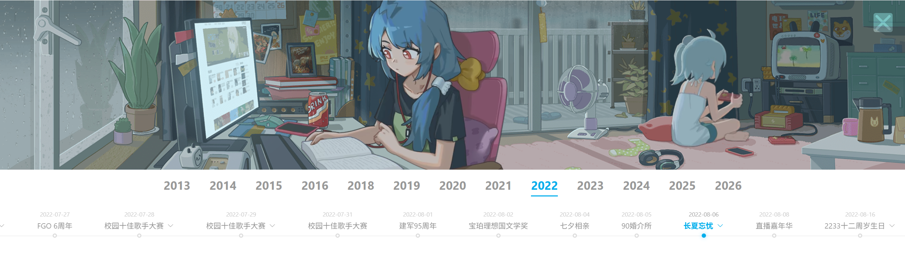

# Bilibili Banner 档案馆

一个围绕 Bilibili Banner 的电子档案与还原项目。

项目收集并整理了 Bilibili 从 2013 年至今的大部分 Banner，结合公开页面、历史快照与逆向分析结果，高度还原了不同时期 B 站顶栏的视觉表现与核心交互逻辑。

## 🚀 [在线预览](https://bilibili-banner.dankt.in/)

<div align="center">




</div>

## 🌟 核心特性

- 🕰️ **跨越十余年的记录**：收录自 2013 年至今的大部分 Banner，覆盖从静态单图到多图层动态 Banner 的演变过程。
- 🎯 **动态交互还原**：基于逆向分析复现官方动态 Banner 的交互逻辑，包括视差、位移、模糊、转场等核心效果。
- 🕹️ **季节互动主题扩展**：复现 2022 年推出的春、夏、秋三款季节性互动主题 Banner。
- ⚙️ **工程化数据维护**：提供抓取、解析、校验和资源归档工具，方便新增数据并维护现有存档。


## 🛠️ 快速开始

```bash
# 1. 安装依赖
pnpm install

# 2. 本地开发
pnpm dev

# 3. 构建与预览
pnpm build
pnpm preview
```

## 📚 文档中心

本项目提供了详尽的架构设计与技术演进参考文档：

- 🏗️ **[项目架构总体设计](docs/architecture/README.md)**：系统定位、数据模型、物理资产组织与 Banner ID 规范
- 🛠️ **[自动化工具链设计](docs/architecture/scripts-architecture.md)**：采集流水线生命周期、Logo 图像算法与合规校验机制
- 📜 **[B站 Banner 技术演进历程](docs/reference/bilibili-banner-evolution.md)**：2013 年至今 B 站顶栏演变与官方渲染引擎深度剖析
- 🧭 **[B站分区体系与 Banner 配置解析指南](docs/reference/bilibili-partition-and-banner-guide.md)**：全量 31 个分区 tid 对照表、channelId 机制与接口规范

## 📥 数据维护简引

本项目内置了完整的自动化采集、治理与数据校验工具链：

### 1. 自动采集入库

自动探测 B 站首页及全部 31 个分区，下载图层切片与 Logo，并原子同步写回 `src/manifest/{YYYY}.json`。

```bash
# 执行自动化抓取入库
pnpm grab
```

### 2. 元数据格式校验与资源完整性校验

基于 TypeScript 类型动态校验 Schema 合规性，并执行资源文件与 Manifest 的双向孤儿检测。

```bash
# 执行完整数据与切片一致性校验
pnpm check-data
```

### 3. Logo 变种审查与归一化治理

由于 B 站历史上存在大量高度相似的白色 Logo 切片，仅在尺寸、边距与位置上有细微差异，可使用此命令通过两阶段人机协同审查与安全归档收敛 Logo 变种。

```bash
# 执行 Logo 审查扫描或批量应用治理
pnpm clean-logo
```

> [!TIP]
> **参数查询**：各脚本支持的完整选项可通过追加 `--help` 查看（例如通过 pnpm grab --help 查阅全部 31 个支持的分区 ID 列表）。
> 
> **主题命名**：自动抓取的 Banner 标题（name）默认取自 Banner title 或分区名，入库后建议在 [src/manifest/](src/manifest/) 对应的年份配置文件中修改为直观的主题名称

## 🤝 参与贡献

感谢您对本项目的关注！

- **提交流程须知**：**仅限 Bug 修复与纯文档修正可以直接提交 PR**；其余贡献（包括新功能、流程优化等）请先发起 [Issue](https://github.com/b23-org/bilibili-banner/issues) 讨论。
- **提交规范**：Git Commit 请遵循英文祈使句格式（例如 `Fix layer parallax translation calculation`）。

更详尽的开发环境配置、规范要求与完整协作流程，请参阅完整的 [贡献指南](.github/CONTRIBUTING.md)。

## ❤️ 鸣谢

- 感谢 [Bilibili][bilibili] 设计师们带来的精美艺术作品
- 早期开发参考：[palxiao/bilibili-banner](https://github.com/palxiao/bilibili-banner)

## 📄 协议与声明

- 代码部分采用 [MIT License](LICENSE)。
- 项目中的图片、视频及原始设计版权归 [Bilibili][bilibili] 所有。

[bilibili]: https://www.bilibili.com
