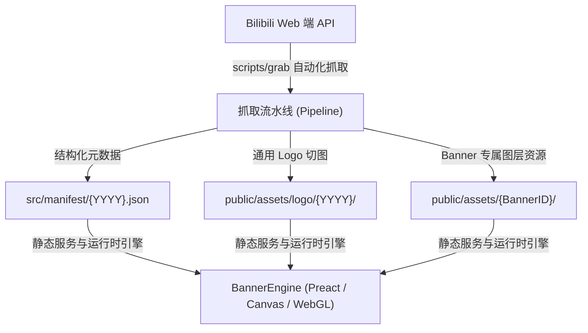
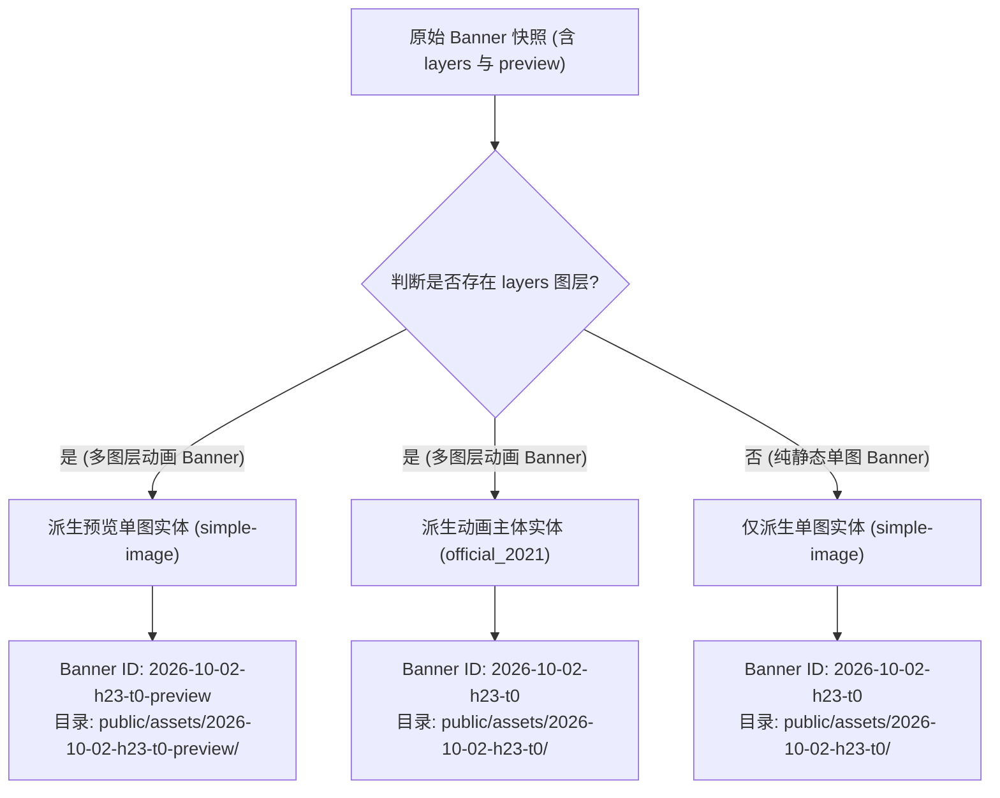

# Bilibili Banner 项目架构总体设计

本文档阐述 Bilibili Banner 项目的整体架构设计、数据组织模型以及核心标识符规范。关于资产抓取流水的详细设计推导，请参阅 [Grab 流水线架构设计文档](./grab-design.md)。

---

## 一、系统定位与数据模型

本项目致力于采集、解析、存储与高保真还原播放 Bilibili 各分区的历史与实时 Banner。系统遵循**静态化驱动**与**资源解耦**原则：



### 1. 数据与静态资产组织
- **元数据索引 (`src/manifest/{YYYY}.json`)**：
  - 按年份划分为时间序的 JSON 清单文件。
  - 记录每个日期的 Banner 条目列表（包含名称、标签、TID 分区列表、配置模式及静态资源相对引用）。
- **静态资源目录 (`public/assets/`)**：
  - **专属图层目录 (`{BannerID}/`)**：存放每个 Banner 特有的图层切图、视频或背景。
  - **公共 Logo 目录 (`logo/{YYYY}/`)**：按年份归档公共白色或定制 Logo，支持跨 Banner 复用与去重。

---

## 二、Banner ID 命名与生成规则

`BannerID` 是整个系统中最基础的唯一标识符（Unique Identifier），不仅作为 Manifest 中每个条目的 `id`，而且直接映射为本地磁盘与静态服务器上的物理资源目录名称（`${WORKSPACE_ROOT}/public/assets/${BannerID}/`）。

### 1. 命名规范格式

Banner ID 严格采用全小写、中划线分隔的命名规范：

```text
${date}-h${hour}-t${primaryTid}[-${suffix}]
```

| 字段组成 | 格式与示例 | 设计语义与生成规则 |
| :--- | :--- | :--- |
| **`date`** | `YYYY-MM-DD`<br/>*(例如 `2026-10-02`)* | 抓取时的本地标准日期（按年-月-日两位补零），提供最高层级的时间序检索维度。 |
| **`h${hour}`** | `h` + 两位小时数 `00~23`<br/>*(例如 `h00`, `h23`)* | 抓取时的本地整点小时数。由于 B 站可能在同一天内的不同时段更换活动 Banner，小时标识保证了天内的时段细分与版本区分。 |
| **`t${primaryTid}`** | `t` + 整数 TID<br/>*(例如 `t0`, `t1004`)* | **主分区标识**。当同一款 Banner 同时在多个分区下发时，抓取引擎会自动合并它们的分区列表并按数字升序排列，取其中最小的 TID 作为主标识（`0` 代表主站首页，具有最高代表性）。 |
| **`suffix`**<br/>*(可选)* | `-preview` | **实体派生标识**。当快照包含多图层动画（`layers.length > 0`）时，流水线会同时派生出预览单图实体（追加 `-preview`）与动画主体实体（无后缀）。 |

---

### 2. 双实体派生机制（Dual-Entity Derivation）

B 站官方的动态 Banner API 在返回多图层动画的同时，通常会提供一张兜底预览单图（Preview Image）。为了保证离线回放体验与静态预览能力，流水线采用双实体生成策略：



- **实体 1：预览单图实体 (`simple-image`)**
  - **ID 格式**：`${date}-h${hour}-t${primaryTid}-preview`
  - **名称规则**：`${displayName} (预览)`
  - **资源目录**：落盘至专属目录 `public/assets/${date}-h${hour}-t${primaryTid}-preview/`
  - **标签**：`["img"]`
- **实体 2：多图层主体实体 (`official_2021`)**
  - **ID 格式**：`${date}-h${hour}-t${primaryTid}`（无后缀）
  - **名称规则**：`${displayName}`
  - **资源目录**：落盘至专属目录 `public/assets/${date}-h${hour}-t${primaryTid}/`
  - **标签**：根据图层资源类型推导为 `["split-layer"]` 或 `["video"]`

---

### 3. ID 与物理资产路径映射对照示例

以 2026 年 10 月 2 日 23 点主站首页（TID=0）投放的一款秋季动态 Banner 为例：

```text
public/assets/
├── 2026-10-02-h23-t0-preview/              <-- 预览实体专属目录 (ID: 2026-10-02-h23-t0-preview)
│   └── 3f8b1c4e...png                      <-- 静态预览单图切图
├── 2026-10-02-h23-t0/                      <-- 动画主体专属目录 (ID: 2026-10-02-h23-t0)
│   ├── layer_bg.png
│   ├── layer_character.png
│   └── layer_foreground.png
└── logo/2026/                              <-- 年份公共 Logo 目录 (跨 Banner 共享)
    └── cc7076d2639f877181621311ded1d425d29a89bd.png
```

---

## 三、相关设计文档索引

- [Grab 抓取流水线架构设计与去重闭环推导](./grab-design.md)
- [B站历史 Banner 演进图鉴](../bilibili-banner-evolution.md)
- [B站分区与 Banner 技术指南](../bilibili-partition-and-banner-guide.md)
