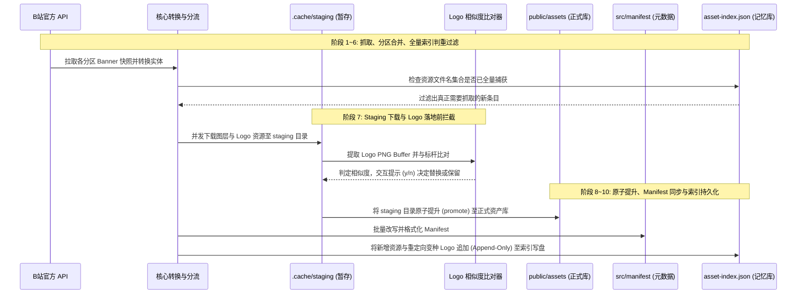

# Grab 抓取流水线架构设计与去重闭环推导

本文档详细记录 `scripts/grab` 抓取流水线的架构设计推导、关键决策背景，以及不可妥协的工程设计原则。总体设计与 Banner ID 规范请参考 [总体设计文档](./README.md)。

---

## 一、流水线核心生命周期

`scripts/grab/pipeline.ts` 是自动化资产采集的核心编排器，其生命周期划分为 10 个标准阶段：



---

## 二、架构决策一：为什么在 Staging 暂存阶段下载并在落地前进行比对？

### 1. 痛点背景
B 站 Web 端在不同时期、不同活动下发的官方白色 Logo 切图存在大量“肉眼几乎无法分辨”的微小变种：
- 有效内容完全一致，仅四周透明留白（Padding）不同（如偏右 1~3px）；
- 导出时抗锯齿微调造成的边缘像素轻微差异；
- 画布尺寸相同但内部有效轮廓缩放微调。

如果直接按照 CDN 文件名哈希写入 `public/assets/logo/{YYYY}/`，会导致每个年份膨胀出上百个重复的白色 Logo 切图。

### 2. 为什么不在下载前仅凭 URL 比对？
- B 站 CDN 图片文件名基于哈希生成，不同微变种具有完全不同的 URL Basename；
- 必须拿到完整本地图像二进制 Buffer，才能解码 PNG 数据并进行 Alpha 像素矩阵轮廓分析。

### 3. 为什么选择在 Staging 阶段介入，而非直接落入正式库后再做清理？
1. **网络并发与计算密集型解耦**：
   - 抓取阶段通过 `concurrency.ts` 维持高并发网络下载通道；
   - 若在下载流中串行进行 PNG 像素级解析，会严重阻塞网络吞吐；先统一快速暂存到 `.cache/staging/`，保持网络层纯粹高效。
2. **阻断变种切图污染正式库（Zero-Pollution Principle）**：
   - 一旦变种切图落入 `public/assets/logo/`，就会产生悬空文件或被其他并发逻辑引用；
   - 在暂存区完成比对与交互决策：
     - 若人工确认替换（输入 `y`）：直接将当前 Banner 的 Manifest `logo.src` 指向预设的标杆 Logo（`scripts/grab/data/standard-white-logo.json`），同时**丢弃暂存的变种文件**，变种文件终生不进入正式库；
     - 若确认保留（输入 `n`）或为定制彩色 Logo：正常提升发布至 `public/assets/logo/`。

---

## 三、架构决策二：为什么去重索引（asset-index.json）必须永久保留并只增不减？

### 1. 角色定位：全集白名单记忆库
[scripts/grab/data/asset-index.json](file:///home/shatty/project/b23-org/bilibili-banner/scripts/grab/data/asset-index.json) 是受 Git 跟踪的核心数据文件：
- 它**不是**仅仅反映当前物理磁盘目录现状的文件列表；
- 它是历史上所有已知资源的**“全集白名单记忆库”**。

### 2. 联合判重机制与回流漏洞（The Dedup Loophole）
抓取流水线的判重核心（`scripts/grab/core/dedup.ts`）是将每个 Banner 的全部切图（图层 + Logo）视作一个不可分割的整体：

```typescript
export function isEntryAlreadyCaptured(
  entry: GrabEntry,
  existingFileNames: ReadonlySet<string>,
): boolean {
  return entry.resourceUrls.every((url) => {
    const fileName = extractFileNameFromUrl(stripCdnSuffix(url));
    return fileName ? existingFileNames.has(fileName) : false;
  });
}
```

假设我们对历史库中的冗余变种 Logo 进行了清理，将物理文件从 `public/assets/logo/` 移动或删除：
- **致命陷阱**：若此时同步从 `asset-index.json` 中删除了该变种 Logo 的文件名；
- **回流故障**：未来定时抓取任务再次扫描 B 站历史分区或已有 Banner 时，API 下发的条目中依然引用着那个变种 Logo 的 URL；
- **后果**：流水线计算发现该变种文件名不在 `asset-index.json` 中，从而**误判该条目为“新资源”**，进而对该 Banner 的所有切图重新发起全量网络下载，彻底破坏抓取幂等性。

### 3. Append-Only（只增不减）原则
为了确保判重闭环永远有效：
1. **永久保留**：即使某个变种 Logo 的物理切图已被合并归档移至 `temp/logo/`，其原始文件名也**必须永久留在 `asset-index.json`** 中。
2. **重定向即记录**：在 Grab 交互过程中，即使人工确认将变种重定向到了标杆 Logo 并丢弃了暂存文件，该变种 Logo 的文件名同样必须被追加到内存 `assetIndex` 中，并在流水线末尾（步骤 10）统一原子持久化。
3. **禁止反向修剪**：即使触发扫盘恢复（`scanAndRebuildIndex`），也必须先加载已有 `asset-index.json` 进行并集（Union）合并，绝对不允许以当前磁盘物理文件缺失为由反向剔除记录。

---

## 四、设计总结与维护红线

| 机制 | 黄金法则 | 违反后果 |
| :--- | :--- | :--- |
| **Logo 暂存比对** | 落地正式库前必须在 Staging 暂存区完成像素分析与终端人工确认 | 导致微变种白色 Logo 持续污染正式库，引起冗余切图膨胀 |
| **资产索引更新** | `asset-index.json` 实行严格 Append-Only，永久保留变种文件名 | 导致历史已抓取 Banner 发生判重回流，触发重复下载 |
| **文件物理归档** | 冗余 Logo 仅可移动至 `temp/logo/{YYYY}/` 安全归档，严禁无备份硬删除 | 丢失原始切图证据，无法追溯历史对齐状态 |
