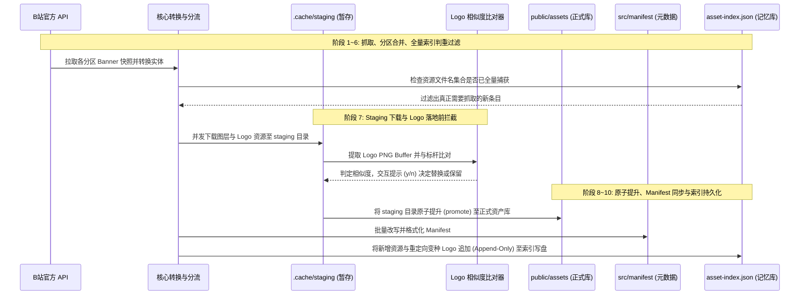

# Grab 抓取流水线架构设计与去重闭环推导

本文档详细记录 `scripts/grab` 抓取流水线的架构设计推导、关键决策背景，以及工程设计原则。

---

## 一、流水线核心生命周期

`scripts/grab/pipeline.ts` 是自动化资产采集的核心编排器，其生命周期划分为 10 个标准阶段：

---

## 二、架构决策一：基于 Staging 暂存区的 Logo 落地前像素比对与准入控制

### 1. 决策背景与痛点问题
B 站 Web 端在不同时期、不同活动下发的官方白色 Logo 切图存在大量“肉眼几乎无法分辨”的微小变种：
- 有效内容完全一致，仅四周透明留白（Padding）不同（如偏右 1~3px）；
- 导出时抗锯齿微调造成的边缘像素轻微差异；
- 画布尺寸相同但内部有效轮廓缩放微调。

若直接按照 CDN 文件名哈希写入 `public/assets/logo/{YYYY}/`，会导致每个年份膨胀出上百个重复的白色 Logo 切图，造成资产冗余与存储膨胀。

### 2. 设计原因：二进制分析依赖与网络吞吐解耦
1. **纯凭 URL 判别的盲区**：
   - B 站 CDN 图片文件名基于哈希生成，不同微变种具有完全不同的 URL Basename；
   - 无法仅在请求前通过 URL 识别其视觉实质，必须拉取到本地完整的图像二进制 Buffer，解码 PNG 数据后进行 Alpha 像素矩阵轮廓分析。
2. **解耦网络高并发与计算密集型操作**：
   - 抓取阶段通过 `concurrency.ts` 维持高并发网络下载通道；
   - 若在网络下载数据流中串行插入高算力的 PNG 像素级解析，会严重阻塞网络通道吞吐；因此先统一快速下载暂存到 `.cache/staging/`，保持网络层纯粹高效。

### 3. 落地方案：暂存拦截与正式库零污染（Zero-Pollution Principle）
流水线选择在资产正式入库前进行准入控制与拦截处理：
1. **隔离暂存**：新下载的切图统一暂存至 `.cache/staging/`，与正式资产库物理隔离；
2. **落地前比对与交互决策**：
   - 比对器（Matcher）提取暂存 Logo 的 PNG Buffer，计算与标杆 Logo（`scripts/grab/data/standard-white-logo.json`）的轮廓相似度；
   - 若人工确认替换（输入 `y`）：直接将当前 Banner 的 Manifest `logo.src` 指向预设的标杆 Logo，同时**销毁暂存的变种文件**，确保变种切图终生不污染正式库；
   - 若确认保留（输入 `n`）或识别为彩色定制 Logo：执行原子提升（Promote）发布至正式目录 `public/assets/logo/`。

---

## 三、架构决策二：去重索引（asset-index.json）的只增不减（Append-Only）持久化机制

### 1. 决策背景：全集记忆库定位与联合判重规则
[scripts/grab/data/asset-index.json](../../scripts/grab/data/asset-index.json) 是受 Git 跟踪的核心数据文件：
- **记忆库定位**：它并非仅仅反映当前物理磁盘目录现状的文件镜像，而是历史上所有已知资源的**“全集白名单记忆库”**。
- **联合判重机制**：抓取流水线的判重核心（`scripts/grab/core/dedup.ts`）将每个 Banner 的全部切图（图层 + Logo）视作一个不可分割的整体，只有全部资源文件均已存在于索引时才视为已抓取

### 2. 设计原因：防范反向修剪引发的“判重回流漏洞”（The Dedup Loophole）
当对历史库中的冗余变种 Logo 进行物理清理（例如移动至 `temp/logo/` 或丢弃暂存文件）时，若同步反向剔除 `asset-index.json` 中的对应记录，会导致严重的判重失效：
- **回流故障机理**：定时任务再次扫描 B 站历史分区或已有 Banner 时，官方 API 下发的条目中仍引用着该变种 Logo 的原始 URL；
- **误判与穿透**：流水线计算发现该文件名缺失于 `asset-index.json`，判定其为“新资源”，进而针对该 Banner 的全部图层再次触发全量网络下载；
- **破坏幂等性**：清理操作直接引发已抓取资源的重复回流拉取。

### 3. 落地方案：Append-Only 闭环保障与防反向修剪
流水线确立了只增不减（Append-Only）的持久化原则：
1. **永久保留历史条目**：即使变种切图物理文件已归档迁移，其文件名也必须永久驻留于 `asset-index.json` 中。
2. **重定向即记录**：交互过程中被重定向并销毁物理文件的变种 Logo，其原始文件名必须同步追加至内存索引，并在流水线末尾统一持久化写盘。
3. **禁止反向修剪（Union-Only）**：即使触发全盘扫描恢复逻辑（`scanAndRebuildIndex`），也必须先加载已有索引并求并集（Union），严禁以“当前物理磁盘缺失该文件”为由反向剔除记录。

---

## 四、设计总结与维护红线

| 机制 | 黄金法则 | 违反后果 |
| :--- | :--- | :--- |
| **Logo 暂存比对** | 落地正式库前必须在 Staging 暂存区完成像素分析与终端人工确认 | 导致微变种白色 Logo 持续污染正式库，引起冗余切图膨胀 |
| **资产索引更新** | `asset-index.json` 实行严格 Append-Only，永久保留变种文件名 | 导致历史已抓取 Banner 发生判重回流，触发重复下载 |
| **文件物理归档** | 冗余 Logo 仅可移动至 `temp/logo/{YYYY}/` 安全归档，严禁无备份硬删除 | 丢失原始切图证据，无法追溯历史对齐状态 |
