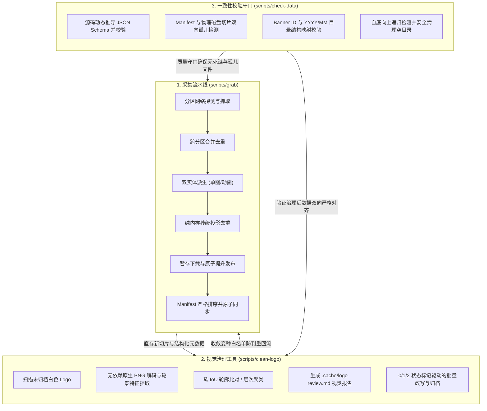
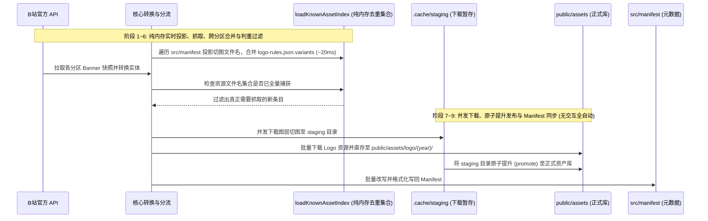
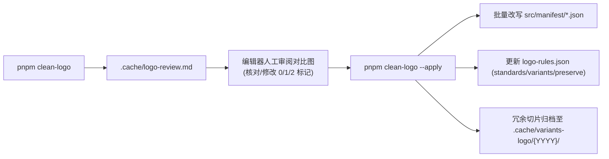

# Scripts 自动化工具链设计

本文档阐述 `scripts/` 目录下全部自动化工具链的系统架构设计、底层数据流模型、核心图像算法以及工程维护红线。

---

## 一、工具链总体架构与协同闭环

`scripts/` 目录承担了项目从**外部数据采集**、**离线视觉治理**到**元数据合规校验**的全生命周期工程支撑，包含三个互相解耦又高度闭环的核心子系统：

### 1. 采集直存与两阶段离线治理解耦设计
为了保证在 CI/CD 与定时任务中无人值守运行，系统将“网络资产抓取”与“变种数据清洗”解耦为两个独立工具链：
- **主流水线纯自动化直存 (`pnpm grab`)**：网络下载管道保持零交互、零阻塞。所有未命中已知库的资源（包含切片与新 Logo）如实直存入库并登记至 Manifest，完全适配自动化调度。
- **两阶段离线数据治理 (`pnpm clean-logo`)**：
  - **阶段一（探测与 Markdown 报告生成）**：扫描未收录的白色 Logo，解码轮廓并评估居中度偏差，在 `.cache/logo-review.md` 中生成并排对比大图与测量数据，第一列提供 `0/1/2` 三态标记；
  - **阶段二（批量应用与安全归档）**：人工在编辑器审阅确认后执行 `--apply`，工具批量改写 Manifest 重定向至标杆，将变种文件名追加至白名单以防回流，并在 0 引用安全确认后将冗余切片移入 `.cache/variants-logo/{YYYY}/` 临时归档。

---

## 二、Banner 自动化抓取流水线 (`scripts/grab`)

`scripts/grab` 是自动化资产采集的核心系统，入口为 `scripts/grab/pipeline.ts`。

### 1. 流水线核心生命周期
抓取流水线的执行生命周期划分为 9 个高效执行阶段：

### 2. 双实体派生机制 (Dual-Entity Derivation)
B 站动态 Banner API 在返回多图层动画的同时，通常包含一张兜底预览单图。为了保证离线回放体验与静态预览能力，流水线采用双实体生成策略：
- **预览单图实体 (`simple-image`)**：
  - **ID 格式**：`${date}-h${hour}-t${primaryTid}-preview`；
  - **名称规则**：`${displayName} (预览)`；
  - **分类标签**：`["img"]`；
  - **物理目录**：落盘至专属目录 `public/assets/${YYYY}/${MM}/${BannerID}/`。
- **多图层主体实体 (`official_2021`)**：
  - **ID 格式**：`${date}-h${hour}-t${primaryTid}`（无后缀）；
  - **名称规则**：`${displayName}`；
  - **分类标签**：根据图层资源推导为 `["split-layer"]` 或 `["video"]`；
  - **物理目录**：落盘至专属目录 `public/assets/${YYYY}/${MM}/${BannerID}/`。

### 3. 基于全量 Manifest 实时投影与变种白名单的纯内存去重
在媒体切片解耦上云后，系统彻底废除传统的磁盘静态索引文件与全盘扫盘开销，采用轻量高效的纯内存判重体系：
1. **实时秒级投影 (`loadKnownAssetIndex`)**：
   - 随用随算，以全量 `src/manifest/*.json` 作为唯一的真实数据源（Single Source of Truth）；
   - 启动时遍历 2013 年至今全部 Manifest 文件提取所有引用的切图文件名，实测耗时仅约 **20ms**，零磁盘缓存维护成本。
2. **防范反向修剪与判重回流闭环 (The Dedup Loophole)**：
   - 历史上被治理替换并丢弃物理切片的变种 Logo 文件名，收敛记录于 `scripts/grab/data/logo-rules.json` 的 `variants` 数组中；
   - 纯内存判重在初始化时将 Manifest 投影集合与 `variants` 取并集（Union）；
   - 当抓取流水线再次拉取到引用该变种 URL 的条目时，内存索引依然命中并判定为“已捕获”，彻底终结历史资源的重复回流拉取。

### 4. 暂存区与原子发布机制 (Atomic Promotion)
为了避免网络异常或下载中断导致正式资产库出现破损半成品：
- **Staging 暂存**：所有图层与切片首先并发下载至 `.cache/staging/${BannerID}/`；
- **原子提升**：条目所有切片完整落地后，通过目录重命名原子提升至 `public/assets/${YYYY}/${MM}/${BannerID}/`。若目标已存在则先备份，在提升异常时触发事务回滚，确保正式资产库的原子完整性。
- **Manifest 格式化与严格排序**：写入 `src/manifest/{YYYY}.json` 时，强制预览实体（`-preview`）排在第 1 位（索引 0），其余条目按主分区 TID 升序与小时数升序排列。

## 三、白色 Logo 视觉审查与离线清洗 (`scripts/clean-logo`)

`scripts/clean-logo` 是专门针对 B 站官方白色切图边缘留白微调变种的离线治理工具。

### 1. 核心图像算法与特征分析
为了保证工具链轻量通用，工具在纯 TypeScript 中实现无第三方 C++ 原生库依赖的图像处理：
- **原生 PNG 解码器 (`decodePngRgba`)**：
  支持 Color Type 6 (RGBA)、4 (Grayscale+Alpha)、3 (Indexed)、2 (RGB)、0 (Grayscale)，完整适配 Adam7 隔行扫描与 Paeth 滤波预测器。
- **几何与居中度诊断 (`evaluateBBoxCentering`)**：
  提取可见像素的最小外接矩形（Alpha BoundingBox），并计算其在画布中的偏移距离，自动输出如 `🎯 正中心`、`*(偏左 2px, 偏上 1px)*` 的直观标签。
- **软 IoU 轮廓比对 (`calculateLogoSimilarity`)**：
  将有效区域投射至 48x24 归一化网格，计算形状轮廓交并比（Soft IoU）。
- **层次聚类 (`clusterWithCompleteLinkage`)**：
  在新年份冷启动（无标杆）时，采用完全链接层次聚类将相似切片自动归组，推举居中度高、面积大的切片作为组内基准。

### 2. 人机协同两阶段工作流

1. **阶段一：生成审查报告**
   运行 `pnpm clean-logo [-y YYYY]`。工具扫描 `public/assets/logo/{YYYY}/` 中未收录的切片，输出 Markdown 报告至 `.cache/logo-review.md`。
   - 表格第 1 列为状态标记位，通过隐藏 HTML 注释保留文件名（例如 `2<!-- 0daf...png -->`），为对比大图留出最大渲染空间；
   - 状态标记语义：
     - **`0`：标准标杆**（设定为该年份官方基准，写入 `standards[year]`）；
     - **`1`：忽略保护**（免检白名单，作为独立定制切片永久保留，写入 `preserve`）；
     - **`2`：待替换变种**（等效变种，Manifest 改写重定向至标杆，切片归档，写入 `variants`）。
2. **阶段二：批量应用与闭环归档**
   运行 `pnpm clean-logo --apply`。
   - **防呆安全校验**：校验每个年份仅允许一个 `0` 标杆，变种 `2` 必须存在对应的标杆；
   - **Manifest 批量改写**：将全量 Manifest 中的 `logo.src` 统一重定向至标杆；
   - **零引用安全校验**：全量重新扫描 Manifest，确认待归档切片处于 0 引用状态；
   - **物理切片归档**：将变种切片从 `public/assets/logo/{YYYY}/` 移动至 `.cache/variants-logo/{YYYY}/`（绝不硬删除，未发生移动的年份绝不生成空目录）。

---

## 四、数据一致性校验与目录合规检查 (`scripts/check-data`)

`scripts/check-data` 负责保障全量元数据与物理磁盘资产严格对齐，是数据质量的核心守门工具。

### 1. Single Source of Truth 动态 Schema 校验
- 系统直接调用 `ts-json-schema-generator`，从 TypeScript 核心定义文件 `src/types.ts` 中的 `BannerEntry` 动态推导 JSON Schema；
- 使用 `Ajv` 对 `src/manifest/*.json` 的所有条目进行严格格式与字段校验；
- 杜绝维护静态 JSON Schema 产生的分步不同步问题，实现“代码定义即校验契约”。

### 2. 双向孤儿与完整性检测
校验流水线执行严格的“双向对齐”策略，不放过任何断链或无主切片：
1. **正向资源存在性校验**：
   Manifest 引用的所有切片（图层切片、视频、Logo）必须在物理磁盘真实存在。若不存在报 `missing-asset`。
2. **Logo 年份一致性校验**：
   校验 Banner 所属年份与引用的 `logo/YYYY/` 年份是否匹配，防止跨年份误引用。若不匹配报 `logo-year-mismatch`。
3. **反向孤儿资源检测**：
   物理磁盘 `public/assets/` 下的所有物理切片，必须至少被一个 Manifest 条目引用。若存在未引用的冗余文件报 `extra-asset`。
4. **Banner ID 与物理目录双向映射**：
   - 校验 `ref.id` 符合 `YYYY-MM` 的目录结构映射；
   - 校验物理目录必须有 Manifest 配置，Manifest 配置必须有物理目录（非交互式 Banner）。若不匹配报 `missing-asset-directory` 或 `missing-manifest-config`。

### 3. 自底向上空目录清理
- 扫描 `public/assets/` 目录树，自动排除 `.DS_Store` 干扰；
- 采用自底向上的深度遍历算法识别所有空目录；
- 在 `--clean` 参数下执行安全删除，保持资产库整洁。

---

## 五、工程设计准则与维护红线

| 维度 | 核心原则 | 违反后果 |
| :--- | :--- | :--- |
| **抓取流水线交互** | 主流水线 `pnpm grab` 保持 100% 纯自动化与零交互，遇新切片如实直存 | 阻塞终端并发，阻碍 CI/CD 自动化集成调度 |
| **去重判重索引** | 坚持纯内存实时投影（`loadKnownAssetIndex`），严禁恢复任何形式的持久化索引文件或扫盘参数 | 破坏新克隆环境开箱即用能力，增加磁盘缓存失效与维护成本 |
| **Logo 治理闭环** | 确认替换变种时必须同步追加至 `logo-rules.json.variants` 并归档切片 | 导致历史已抓取 Banner 发生判重回流，触发重复下载 |
| **物理切片处置** | 治理工具通过 0 引用校验后安全移入 `.cache/variants-logo/`，严禁无备份硬删除 | 丢失原始切图证据，无法追溯历史对齐状态 |
| **数据源契约** | `check-data` 坚持从 `src/types.ts` 动态推导 Schema，禁止手写维护静态 Schema 文件 | 产生定义漂移与双重维护负担 |
