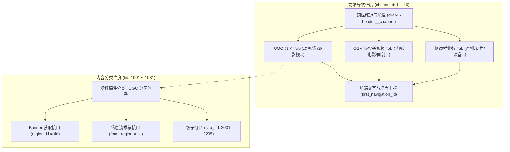

# B 站分区体系与 Banner 配置解析指南

> [!NOTE] 
> 本文档分析与接口验证基于 **2026 年 10 月** 的 B 站线上生产环境及前端最新架构。随着 B 站业务迭代与前端改版，相关 API 路径、内部参数或分区组织形式可能会发生演进，请以最新实际网络请求为准。

本文档系统梳理了 Bilibili 网站（以下简称 B 站）顶栏导航栏、分区分类体系（`tid` 与 `channelId`）以及 Banner 接口配置的底层机制与调用方式，为 Banner 抓取、数据维护与前端还原提供技术参考。

---

## 一、核心概念解析：tid 与 channelId 的区别

初次接触 B 站数据接口时，容易混淆 `tid` 与 `channelId`。两者分别代表了不同的业务体系与抽象层级：



### 1. `tid`（Type ID / Region ID，分区分类 ID）
* **定位**：面向**视频内容与后台稿件**的核心分类标识。
* **作用**：B 站建站以来一直沿用的 UGC 视频分区体系编码。在投稿系统、视频播放详情、分区推荐流以及 Banner 接口中，均以 `tid` 作为入参标识。
* **取值特征**：
  * 主站首页为 `0`；
  * 常规主分区统一分布在 **`1001 ~ 1031`**（如影视 1001、动画 1005、游戏 1008 等）；
  * 二级子分区（例如“动漫剪辑”、“AI学习”）分布在 **`2001 ~ 2205`**；
  * 非 UGC 视频业务（如番剧、电影、直播、专栏等）在分区体系中没有通用 UGC 编码，其 `tid` 均为 `0`。

### 2. `channelId`（Channel ID / Navigation ID，频道导航 ID）
* **定位**：面向**页面组织与前端 UI**的导航菜单抽象编码。
* **作用**：B 站首页频道化改版后引入的顶栏导航容器 ID，用于前端统管导航栏上的所有可点击按钮、控制高亮状态、处理吸顶交互以及点击埋点。
* **取值特征**：
  * 采用连续自然数编码（范围约为 `1 ~ 46`）；
  * 无论是否属于常规视频分区，只要在导航栏上占有一个按钮位置，就拥有唯一的 `channelId`（例如番剧为 `1`、电影为 `2`、动画为 `7`、游戏为 `8`、专栏为 `38`、直播为 `39`）。

### 3. 两者对比总结

| 维度 | `tid` (Type ID) | `channelId` (Channel ID) |
| :--- | :--- | :--- |
| **层级定位** | 内容/稿件/服务层（后端视频分类） | 视觉/交互/展示层（前端导航入口） |
| **常规分区取值** | `1001 ~ 1031` | `7 ~ 36`、`44` |
| **二级分类** | `sub_tid`（如 2001, 2096） | `subChannelId`（如 250001） |
| **番剧/电影/直播/专栏** | 均为 `0`（不属于普通视频投稿分区） | 均有独立编号（如番剧 1、专栏 38） |
| **接口应用** | 获取 Banner (`region_id`)、信息流推荐 (`from_region`) | 埋点上报 (`first_navigation_id`)、导航切换 |

---

## 二、分区及 tid 的数据来源机制

B 站各分区的元数据（包含 `name`、`route`、`tid`、`channelId` 以及二级子分区列表）并非硬编码在前端页面中，而是托管在 B 站统一的前端配置中心。

### 1. 核心配置 API
前端通过 KV 配置中心服务拉取全量频道映射：
* **请求 URL**：
  ```http
  GET https://api.bilibili.com/x/kv-frontend/namespace/data?appKey=333.1339&nscode=10&unlimit=true
  ```
* **参数说明**：
  * `appKey = "333.1339"`：顶栏频道组件对应的 AppKey / 业务模块标识。
  * `nscode = 10`：主导航频道列表（`channel_list`）对应的命名空间编号。
  * `unlimit = "true"`：指示后端返回未分页截断的全量数据。

### 2. 加载链路：SSR 与客户端异步请求
* **首页加载（服务端渲染 SSR）**：
  在用户访问主站首页（`https://www.bilibili.com/`）时，B 站服务端在内网调用配置服务，并将数据直接序列化注入到 HTML 中的 Pinia 初始状态：
  `window.__pinia.index.headerChannelKvData`
  经实测，该状态内的 `channel_list` 与上述 API 接口返回的内容完全一致（字段差异数为 0）。
* **频道页加载（客户端 CSR）**：
  当用户进入具体频道页面（如动画频道 `/c/douga/`）时，前端通过内置的 KV-SDK 向上述接口发起异步请求，拉取并更新本地缓存。

### 3. 官方前端数据拉取实现源码

B 站前端内部封装的数据拉取实现逻辑如下：

```javascript
// 频道数据配置参数定义
const channelKvConfig = () => ({
  surl: "fe.inf-backend.kv-server",
  stimeout: 200,
  appKey: "333.1339",
  nscode: 10,
  all: true,
  groupNames: [],
});

// 通过 KV-SDK 获取全量频道与分区映射数据
const fetchChannelKvData = async () => {
  try {
    const config = channelKvConfig();
    const data = await new KvClient({
      appKey: config.appKey,
      nscode: config.nscode,
      strict: 1,
      timeout: config.stimeout,
    }).getAll();
    store.headerChannelKvData = data;
  } catch (err) {
    console.error("get channel kv data error", err);
  }
};
```

---

## 三、Banner 配置获取 API 与调用方式

B 站各分区及主站首页的顶栏 Banner，统一通过 `/x/web-show/page/header/v2` 接口进行获取。

### 1. 官方接口调用构造源码

B 站前端针对 Banner 请求的底层封装逻辑如下：

```javascript
// 顶栏 Banner 请求构造函数
const buildBannerRequest = (regionId) => ({
  method: "GET",
  url: "/x/web-show/page/header/v2",
  params: regionId
    ? { category: 1, region_id: regionId } // 传入分区 tid 时，category 为 1
    : { category: 0 },                     // 主站首页 Banner，category 为 0
  config: { internal: true, discovery: "main.web-svr.web-show" },
});
```

### 2. 接口调用规范

#### （1）获取指定分区的 Banner 配置
* **请求 URL**：
  ```http
  GET https://api.bilibili.com/x/web-show/page/header/v2?category=1&region_id=${tid}
  ```
* **参数说明**：
  * `category=1`：表示请求具体频道的 Banner。
  * `region_id`：目标分区的 `tid`（例如动画分区为 `1005`，影视分区为 `1001`）。

#### （2）获取主站首页的 Banner 配置
* **请求 URL**：
  ```http
  GET https://api.bilibili.com/x/web-show/page/header/v2?category=0
  ```
* **参数说明**：
  * `category=0`：表示请求全站主站首页 Banner，无需传递 `region_id`。

### 3. 返回数据结构说明

接口返回示例（简化）：

```json
{
  "code": 0,
  "message": "OK",
  "data": {
    "id": 18239,
    "name": "秋分",
    "pic": "http://i0.hdslb.com/bfs/archive/27cc73b1eb44368966ceca7583d41ec04c43375e.png",
    "litpic": "",
    "url": "https://www.bilibili.com/blackboard/activity-xxx.html",
    "is_split_layer": 1,
    "split_layer": "{\"layers\":[...]}"
  }
}
```

* **`pic`**：Banner 的静态底图/预览图 URL。
* **`is_split_layer`**：标识是否为动态多图层 Banner（`1` 为动态多图层，`0` 为静态单图）。
* **`split_layer`**：当为动态多图层时，该字段为包含完整图层配置的 JSON 字符串。内部包含每个图层的静态图片 URL、初始位移、缩放比例、透明度、视差敏感系数及鼠标交互动画参数。
* **`name`**：Banner 的主题名称（通常在后台配置）。
* **`url`**：用户点击 Banner 时的目标跳转链接。

---

## 四、支持通用 Banner 的分区全量对照表

所有拥有独立 UGC 分区 `tid`（`1001 ~ 1031`）的主分区均支持调用上述 API 获取其 Banner 配置。

| tid | 分区名称 | 英文路由 (`route`) | 对应 `channelId` | 子分区数 | 典型二级子分区示例（含子 tid） |
| :---: | :---: | :---: | :---: | :---: | :--- |
| `0` | 主站首页 | - | 0 | - | - |
| `1001` | 影视 | `cinephile` | 12 | 8 | 影视解读 (2001)、影视剪辑 (2002)、短剧短片 (2005) |
| `1002` | 娱乐 | `ent` | 13 | 7 | 娱乐评论 (2009)、明星剪辑 (2010)、娱乐饭拍 (2011) |
| `1003` | 音乐 | `music` | 10 | 12 | 原创音乐 (2016)、翻唱 (2020)、演奏 (2021)、VOCALOID (2022) |
| `1004` | 舞蹈 | `dance` | 11 | 9 | 宅舞 (2028)、街舞 (2029)、国风舞蹈 (2032)、舞蹈教学 (2033) |
| `1005` | 动画 | `douga` | 7 | 18 | 同人动画 (2037)、模玩周边 (2038)、cosplay (2039)、动漫剪辑 (2041) |
| `1006` | 绘画 | `painting` | 24 | 4 | 二次元绘画 (2055)、非二次元绘画 (2056)、绘画学习 (2057) |
| `1007` | 鬼畜 | `kichiku` | 9 | 5 | 鬼畜调教 (2059)、鬼畜剧场 (2060)、人力VOCALOID (2061)、音MAD (2062) |
| `1008` | 游戏 | `game` | 8 | 16 | 单人RPG (2064)、单机主机 (2066)、MOBA (2070)、休闲小游戏 (2077) |
| `1009` | 资讯 | `information` | 16 | 4 | 时政资讯 (2080)、海外资讯 (2081)、社会资讯 (2082) |
| `1010` | 知识 | `knowledge` | 14 | 12 | 科学科普 (2094)、商业财经 (2087)、人文历史 (2090)、职场发展 (2093) |
| `1011` | 人工智能 | `ai` | 25 | 3 | AI学习 (2096)、AI资讯 (2097)、AI杂谈 (2098) |
| `1012` | 科技数码 | `tech` | 15 | 7 | 电脑 (2099)、手机 (2100)、摄影摄像 (2102)、自制发明 (2104) |
| `1013` | 汽车 | `car` | 19 | 5 | 汽车测评 (2106)、汽车文化 (2107)、汽车生活 (2108)、汽车技术 (2109) |
| `1014` | 时尚美妆 | `fashion` | 20 | 9 | 美妆 (2111)、护肤 (2112)、鞋服穿搭 (2114)、箱包配饰 (2115) |
| `1015` | 家装房产 | `home` | 26 | 4 | 买房租房 (2120)、家庭装修 (2121)、家居展示 (2122) |
| `1016` | 户外潮流 | `outdoors` | 27 | 4 | 露营 (2124)、徒步 (2125)、户外探秘 (2126) |
| `1017` | 健身 | `gym` | 28 | 5 | 健身科普 (2128)、健身跟练教学 (2129)、健身记录 (2130) |
| `1018` | 体育运动 | `sports` | 21 | 10 | 潮流运动 (2133)、足球 (2134)、篮球 (2135)、体育赛事 (2141) |
| `1019` | 手工 | `handmake` | 29 | 6 | 文具手帐 (2143)、轻手作 (2144)、传统手工艺 (2145)、DIY玩具 (2147) |
| `1020` | 美食 | `food` | 17 | 5 | 美食制作 (2149)、美食探店 (2150)、美食测评 (2151)、美食记录 (2152) |
| `1021` | 小剧场 | `shortplay` | 18 | 4 | 剧情演绎 (2154)、语言类小剧场 (2155)、UP主小综艺 (2156) |
| `1022` | 旅游出行 | `travel` | 30 | 4 | 旅游记录 (2158)、旅游攻略 (2159)、城市出行 (2160) |
| `1023` | 三农 | `rural` | 31 | 5 | 农村种植 (2162)、赶海捕鱼 (2163)、打野采摘 (2164)、农业技术 (2165) |
| `1024` | 动物 | `animal` | 22 | 5 | 猫 (2167)、狗 (2168)、小宠异宠 (2169)、野生动物科普 (2170) |
| `1025` | 亲子 | `parenting` | 32 | 7 | 孕产护理 (2172)、婴幼护理 (2173)、萌娃 (2175)、亲子教育 (2177) |
| `1026` | 健康 | `health` | 33 | 6 | 健康科普 (2179)、养生 (2180)、两性知识 (2181)、心理健康 (2182) |
| `1027` | 情感 | `emotion` | 34 | 4 | 家庭关系 (2185)、恋爱关系 (2186)、人际关系 (2187)、自我成长 (2188) |
| **`1028`** | **神秘学** | `mysticism` | 44 | 5 | 塔罗占卜 (2189)、星座占星 (2190)、传统玄学 (2191)、疗愈成长 (2192) |
| `1029` | vlog | `vlog` | 23 | 4 | 中外生活vlog (2194)、学生vlog (2195)、职业vlog (2196) |
| `1030` | 生活兴趣 | `life_joy` | 35 | 5 | 休闲玩乐 (2198)、线下演出 (2199)、文玩文创 (2200)、潮玩玩具 (2201) |
| `1031` | 生活经验 | `life_experience` | 36 | 3 | 生活技能 (2203)、办事流程 (2204)、婚嫁 (2205) |

> **注**：
> 1. `tid: 0`（主站首页）在前端与抓取脚本内部对应的主导航标识 `channelId` 亦记为 `0`；
> 2. `tid: 1028`（神秘学）在 B 站官方接口中真实存在但主站顶栏无入口按钮。
